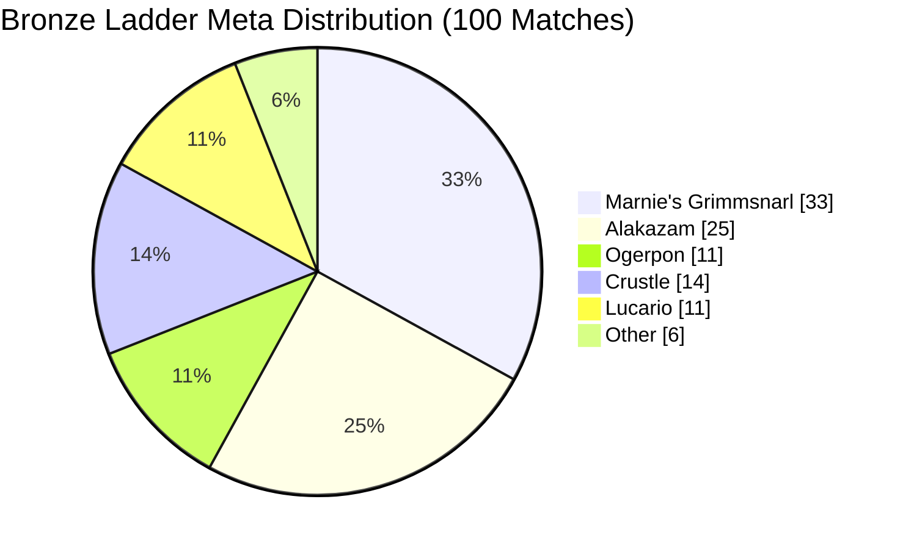

# PTCG Rule-Based Agent

A heuristic rule-based agent for Pokémon Trading Card Game battles, developed through replay analysis, matchup-specific strategy design, and iterative action scoring.

This project was independently developed over approximately one month. **Kaggle result: 561 / 6,807 — Bronze Medal**

The earliest working version was ranked at around **2,000th place**, and later iterations improved through matchup analysis, debugging, deck construction changes, and regression-aware refinement.


## Overview

The agent evaluates all legal actions and assigns each action a heuristic score based on the current game state and the action with the highest score will be chosen.

Instead of using a fixed policy against every opponent, it detects common deck archetypes and adjusts its strategy accordingly.

The project went through roughly 20 and 10 iterations for the Alakazam deck and Starmie deck respectively before the final version was selected.

## Strategy Development Workflow

```mermaid

flowchart LR
    A["Select Candidate Decks"] --> B["Evaluate Deck Strength and Suitability for Training"]
    B --> C["Play Games to Understand the Deck Strategy"]
    C --> D["Implement Initial Heuristic Rules"]
    D --> E["Build V1 Agent"]
    E --> F["Run Games and Review Replays"]
    F --> G["Identify and Group Failure Cases"]
    G --> H["Evaluate Potential Fixes"]

    H --> I{"Worth Fixing?"}
    I -->|Yes| J["Assess Compatibility,Complexity and Regression Risk"]
    I -->|No| K["Accept or Strategically Deprioritize the Weakness"]

    J --> L["Implement Selected Changes"]
    L --> M["Build Next Version"]
    M --> N["Replay Analysis and Regression Testing"]
    N --> O{"Further Improvement?"}

    O -->|Yes| F
    O -->|Near a Performance Plateau| P["Evaluate Multiple Historical Versions<br/>in the New Environment"]
    P --> Q["Compare Robustness and Matchup Performance"]
    Q --> R["Select the Best-Performing Version"]
    R --> F

```




## Core Design

The agent uses a priority-ordered rule system to select actions from the available legal moves. Decision rules are evaluated according to their priority, allowing the agent to respond to different game states without relying on a single fixed strategy.

The scoring system considers factors such as:

- knockout opportunities
- Prize card value
- HP and attached Energy
- hand and deck size
- resource preservation
- opponent archetype
- future value of key cards
- current bench pokemon
- active pokemon

## Matchup-Specific Strategy

Different opponent archetypes can trigger different global policies.

Examples include:

- Alakazam matchups: limit unnecessary card draw to reduce deck-out risk. 
- Crustle matchups: preserve Hammer for higher-value future targets instead of using it immediately

The opponent deck is detected by characteristic core cards. Since all ladder decks are built around one main archetype, this provides a practical classification method, although unusual mixed-core decks may occasionally be misclassified (which is nearly impossible).

Development mainly focuses on the most common ladder archetypes in order to control implementation complexity.


## Major Strategy Revision

Throughout iterative development, changes were primarily focused on improving matchups against the most prevalent archetypes in the meta.



### Marnie Matchup

Against similarly rated Marnie agents, earlier version lost 26/33 episodes. 

Marnie decks also representing roughly 30% of a random Bronze-level ladder sample, making this a high-priority weakness.

Therefore changed the deck construction to include four copies of Battle Cage, with some changes in rule. 

After these changes, the observed win rate against similarly rated Marnie opponents improved to approximately 60% (15/24).


### Alakazam Matchup

The initial agent won 9/25 against similarly rated Alakazam opponents. Several rule-based adjustments were introduced to address this weakness, but the improvements were limited and some changes reduced performance in previously favorable matchups.

I then added one copy of Team Rocket's Articuno as a targeted counter to Alakazam decks. In testing against less experienced Bronze-level Alakazam agents, the observed win rate increased to approximately 80%.

However, performance did not generalize to stronger opponents: the observed win rate against stronger Silver-level Alakazam agents remained low, or even worse.

This result highlighted a limitation of matchup-specific optimization. A strategy that performs well against one opponent population may fail against stronger agents with different decision-making patterns.


### Xerosic Machine Trade-off

Higher-ranked Alakazam decks often used approximately three copies of Xerosic's Machinations to disrupt the opponent's hand.

However, my rule-based agent struggled to determine when to use the card effectively. Simply adopting a similar deck configuration did not produce the expected benefits, as the agent's decision rules could not consistently exploit the card's strategic value.

I therefore reduced the number of copies to one rather than directly imitating higher-ranked deck lists. This experiment reinforced the importance of designing deck construction around the capabilities of the decision-making system.


### Iterative Agent Development

**Initial Exploration — Starmie Archetype**

I initially selected the Staryu/Starmie archetype because it appeared relatively straightforward to play manually. However, translating its strategy into a rule-based agent proved more difficult than expected.

The agent needed to evaluate damage across multiple Pokémon, determine whether combined damage could achieve a knockout, and allocate damage efficiently when a knockout was not immediately possible. These decisions depended heavily on the current board state and the interaction between multiple Pokémon, making them difficult to capture reliably through deterministic rules.

After approximately 11 iterations involving deck construction and strategic adjustments, the leaderboard score remained around 700. I therefore shifted development toward the Alakazam archetype, which proved more promising for my rule-based approach.

**1. Bug Fixes and Baseline Improvements (722–804)**

Early iterations focused on identifying and fixing bugs in action selection and decision-making. Performance fluctuated as issues were progressively resolved.

**2. Strategy Refinement Under a Stronger Meta (763–826)**

Although scores did not improve consistently, the competitive environment became stronger as more capable agents emerged. Further debugging and experimentation with different rule-based strategies helped improve decision-making under increasingly challenging conditions.

**3. Matchup-Specific Optimization (741–900)**

Development shifted toward targeted matchup optimization against prevalent archetypes:

- **765:** Initial rule-based adjustments targeting Alakazam decks, despite little improvements.
- **820:** Preliminary matchup-specific rules extended to other major archetypes.
- **741:** A regression caused by excessive matchup-specific rules and additional adjustments targeting Marnie's Grimmsnarl decks.
- **900:** Focused optimization against Marnie's Grimmsnarl, including four copies of Battle Cage.
- **763:** including three copies of Xerosic's Machinations with different new rules to deal with the Alkazam deck, but regression occurs.
- **833:** One copy of team Rocket's Articuno is added to improve the Alakazam matchup. Slightly harmed the other matchups but greatly improved the Alakazam matchup.
- **820:** Further changes in both deck and rule. Little effects are shown.
- 820 and 766(Further refinements): Additional deck and rule changes failed to produce consistent improvements.

### Final Agent Selection

Two versions were selected for the final submission:

- **Score 900:** The strongest targeted version, further refined by incorporating Articuno into the final configuration. The resulting variant scored **877**, achieving a Bronze-tier result.
- **Score 833:** A more broadly optimized version that scored **831**, with an estimated ranking outside the Bronze tier.


xychart-beta
    title "Kaggle Leaderboard Scores Across Iterations"
    x-axis "Iteration" [1, 2, 3, 4, 5, 6, 7, 8, 9, 10, 11, 12, 13, 14, 15, 16, 17, 18, 19, 20, 21, 22]
    y-axis "Leaderboard Score" 650 --> 920
    line [722, 701, 675, 762, 733, 699, 774, 804, 763, 785, 826, 794, 814, 765, 820, 820, 741, 900, 763, 833, 820, 766]
    
## Failure Categories

During development, the main issues fell into three categories:

- **Implementation and API issues:** Incorrect code, API mismatches, illegal actions, and unhandled edge cases.
- **Decision-making weaknesses:** Poor action priorities, premature resource usage, excessive card draw, and incorrect target selection.
- **Matchup-specific weaknesses:** Strategies that performed poorly against particular archetypes or introduced regressions in previously favorable matchups.

Distinguishing implementation bugs from strategic weaknesses helped determine whether a problem required a code fix, a change to the decision rules, or a trade-off that was not worth addressing.


## Regression Risk and Rule Refinement

One of the most important lessons from the project was that fixing a weakness in one matchup could reduce performance in others.

I therefore did not add a new rule every time a losing case appeared. Instead, I considered:
- **Expected benefit:** How frequently the problem occurred and how much the change might improve performance.
- **Implementation complexity:** Whether the proposed rule would make the decision system harder to maintain.
- **Regression risk:** Whether the change could interfere with existing rules or harm previously favorable matchups.
- **Matchup relevance:** Whether the targeted weakness was important enough to justify a specialized adjustment.

Important matchups were retested manually after selected changes, while Kaggle leaderboard results provided a broader performance reference.

This approach helped balance targeted improvements against the complexity and robustness of the overall policy.


## Limitations

The agent relies on manually designed decision rules rather than a learned policy. Its performance therefore depends on how well the rules represent the strategic value of actions across different game states.

Its main limitations include:

- **Limited generalization:** Rules designed around common archetypes may not perform well against unfamiliar decks or stronger opponents with different strategies.
- **State-dependent decision complexity:** Some decisions require evaluating interactions among multiple Pokémon, future turns, and competing resource priorities, which can be difficult to represent through deterministic rules.
- **Accumulated decision errors:** Small weaknesses in individual decisions can compound over the course of a match.
- **Limited adaptability:** Unlike a learned policy, the rule system does not automatically improve from additional gameplay; improvements require further analysis and manual changes to the rules.

These limitations motivated the use of matchup analysis and iterative testing, while also revealing the difficulty of scaling a manually maintained rule system.

  

## Repository Structure

```text
ptcg-rule-based-agent/
├── README.md
├── AlakazamV19.py
├── deck.csv
└── archive/
    ├── v1_initial_agent.py
    └── staryu_agent.py
```

`AlakazamV19.py` contains the final Alakazam-based agent with 877 scores finally.

The archive contains only representative milestones rather than every intermediate submission.

## Key Takeaway

The project evolved from an initial heuristic agent into a matchup-aware decision system built around priority-ordered rules, opponent archetype detection, resource management, and iterative testing.

The main challenge was not simply adding more rules, but determining which changes were worth implementing. Through repeated debugging, matchup analysis, and manual retesting, I learned that local improvements could introduce regressions elsewhere, and that increasingly complex rules did not necessarily lead to better overall performance.

This project strengthened my understanding of heuristic decision-making, empirical evaluation, and the trade-off between targeted optimization and overall policy robustness.
